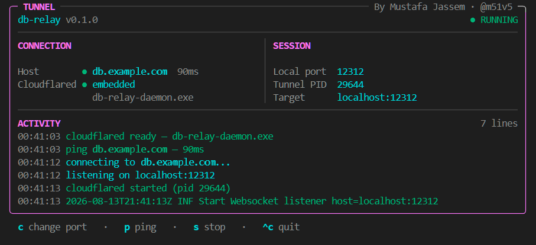
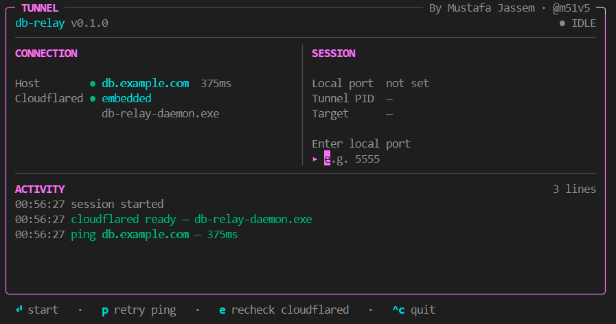

<div align="center">

# db-relay

**Tunnel a remote database to your PC over Cloudflare Zero Trust. No VPN, no open ports.**

[](https://github.com/m51v5/db-relay-release/releases/latest)
[](https://github.com/m51v5/db-relay-release/releases)
[](https://github.com/m51v5/db-relay-release/releases/latest)
[](LICENSE)

© 2026–present · [@m51v5](https://github.com/m51v5) · [m51v5.com](https://m51v5.com)

</div>

---



A small terminal app that opens a **Cloudflare Access TCP tunnel** to a remote PostgreSQL, MySQL or any other TCP database. Point your database client (psql, DBeaver, TablePlus...) at `localhost:<port>` instead of exposing the database to the internet.

```
DB server ──► cloudflared (server) ──► Cloudflare edge ──► db-relay (your PC) ──► localhost:<port>
```

---

## Why db-relay

- No VPN, no port forwarding, no open database ports
- Login handled by Cloudflare Access (SSO with email or group rules, no shared passwords)
- One portable `.exe`, nothing to install
- Terminal dashboard: connection health, session info and live log in one view



---

## Download

From the [latest release](https://github.com/m51v5/db-relay-release/releases/latest):

| File | Use when |
|---|---|
| `db-relay-vX.Y.Z-windows-amd64.zip` | Default. cloudflared `2025.4.0` is built in, nothing else to install |
| `db-relay-external-vX.Y.Z-windows-amd64.zip` | You manage your own `cloudflared.exe` and set its path in `config.yml` |

Unzip anywhere and run the `.exe`. No installer.

**Requirements:**
- Windows, 64-bit
- A domain on Cloudflare with Zero Trust (the free plan works)
- The server side set up once, see [Server setup](#server-setup)

---

## Quick start

1. Set up the server once: [Server setup](#server-setup).
2. Next to the `.exe`, create `config.yml`:
   ```yaml
   host: db.yourdomain.com
   ```
   External build only, also add:
   ```yaml
   cloudflared_path: C:\tools\cloudflared.exe
   ```
   No `config.yml` yet? Run the `.exe` and answer `y`: it writes `config.example.yml` to fill in and rename.
3. Run `db-relay.exe`. It checks the host (TCP 443) and cloudflared, then asks for a local port.
4. Enter a port, such as `5432`. The first connect opens your browser for the Cloudflare Access login.
5. Point your database client at `localhost:<port>`.

| Key | Action |
|---|---|
| `Enter` | Start the tunnel on the entered port |
| `S` | Stop the tunnel |
| `C` | Change the port |
| `P` | Check the host again |
| `E` | Check cloudflared again |
| `Esc` / `Ctrl+C` | Quit, or cancel a port change |

---

## Server setup

DB traffic needs a raw TCP tunnel, not plain HTTP. Cloudflare's "quick tunnel" (temp `trycloudflare.com` URL from `cloudflared tunnel --url ...`) only proxies HTTP/WebSocket — **not** TCP, so that shortcut's out. Pick one setup path:

### Option A — CLI (most control, most steps)

1. Install cloudflared `[required]`
   ```bash
   curl -L https://github.com/cloudflare/cloudflared/releases/latest/download/cloudflared-linux-amd64.deb -o cloudflared.deb
   sudo dpkg -i cloudflared.deb
   ```
2. Authenticate and create a tunnel `[required]`
   ```bash
   cloudflared tunnel login
   cloudflared tunnel create db-tunnel
   ```
   Note the tunnel ID from the output.
3. Configure the tunnel `[required]` — create `~/.cloudflared/config.yml`:
   ```yaml
   tunnel: <tunnel-id>
   credentials-file: /root/.cloudflared/<tunnel-id>.json

   ingress:
     - hostname: db.yourdomain.com
       service: tcp://localhost:5432   # your DB port (5432=postgres, 3306=mysql, etc.)
     - service: http_status:404
   ```
4. Create a Cloudflare Access application `[required — TCP tunnel is unauthenticated without it]`
   1. [Cloudflare Zero Trust](https://one.dash.cloudflare.com) → **Access** → **Applications** → **Add an application** → **Self-hosted**
   2. **Application name**: DB Relay, **Session duration**: as needed *(optional, default fine)*, **Application domain**: `db.yourdomain.com`
   3. **Application type** → **Non-HTTP** → **TCP**
   4. Add an **Access Policy** (allow your user/email/group), Save
5. Route the tunnel to your domain `[required]`
   ```bash
   cloudflared tunnel route dns db-tunnel db.yourdomain.com
   ```
6. Run the tunnel `[required]`
   ```bash
   # Run once to test
   cloudflared tunnel run db-tunnel

   # Or install as a system service [optional, only needed to survive reboot/logout]
   sudo cloudflared service install
   sudo systemctl start cloudflared
   ```

### Option B — Dashboard (detailed, no CLI tunnel config)

1. Install cloudflared `[required]` — same as Option A step 1.
2. Create the tunnel in the dashboard `[required]` — Zero Trust dash → **Networks → Tunnels → Create a tunnel** → **Cloudflared** connector → name it. No `cert.pem`/local config needed.
3. Add a **Public Hostname** `[required]` on the tunnel: hostname `db.yourdomain.com`, **Type**: `TCP`, target `localhost:5432` (or your DB port). This replaces `config.yml`'s ingress block — set manually in the UI.
4. Create a Cloudflare Access application `[required]` — same as Option A step 4.
5. Run the tunnel `[required]` — dash shows a run command after tunnel creation:
   ```bash
   cloudflared service install --token <token>
   ```

### Option C — Dashboard quick path (least manual config)

Same as Option B, but skip hand-configuring the public hostname/ingress — accept the dashboard wizard's defaults where offered, still set **Type: TCP** and the target port when prompted (unavoidable, DB needs it), then just copy-paste the one token command the dash gives you and run it. Still need the Access application (step 4 above) — that's not skippable, it's what authenticates the tunnel.

---

## Privacy

db-relay has no account, telemetry or update check. It only connects to:
- **Your host**, on TCP port 443, to check it's reachable (`P`).
- **Cloudflare**, through `cloudflared access tcp`, which carries the tunnel and does the login.

The login happens in your browser, with whatever your Cloudflare Access policy allows. db-relay never sees your password.

---

## Notes

**Files it uses:**
- `config.yml`, next to the `.exe` or in the folder you run it from.
- Embedded build: copies cloudflared to `%TEMP%\db-relay-daemon.exe` on each start.
- cloudflared keeps the login token in `%USERPROFILE%\.cloudflared\`, so you log in again only when the session expires.

**Remove every trace:** delete the `.exe` folder, `%TEMP%\db-relay-daemon.exe`, and the token files for your host in `%USERPROFILE%\.cloudflared\`.

The local port is open only while the tunnel runs.

---

## License

MIT, see [LICENSE](LICENSE). It covers the released `.exe` files and this repo's docs. The source code is closed.
